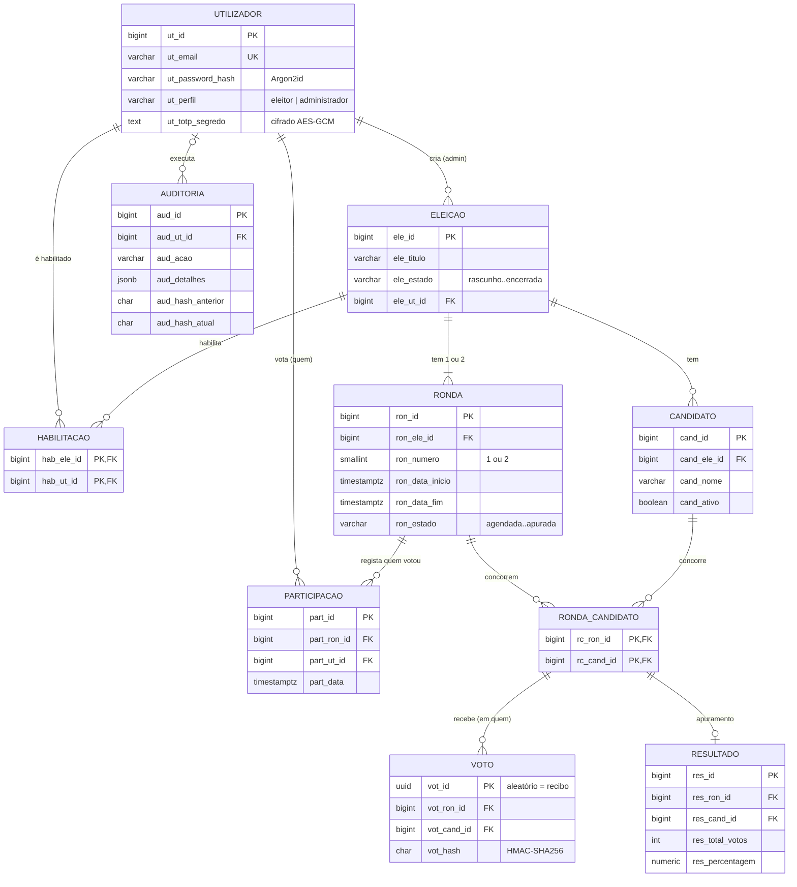

# 1. Modelo de Dados

## Diagrama entidade-relação



> O diagrama usa Mermaid e é desenhado automaticamente no GitHub e no VS Code (com a extensão
> Markdown Preview Mermaid). O pgAdmin também desenha um diagrama: botão direito na BD
> `trustvote` → **ERD For Database**.

## Explicação das relações

**Utilizadores.** Há um único tipo de conta (`utilizador`), com o perfil `eleitor` ou
`administrador`. Os administradores criam eleições (`eleicao.ele_ut_id`); os eleitores são
habilitados para votar em eleições concretas (`habilitacao`).

**Eleição, rondas e candidatos.** Uma eleição tem os seus candidatos e 1 ou 2 rondas
(1.ª volta e, se necessário, 2.ª volta). A tabela `ronda_candidato` diz **quem concorre em cada
ronda**: na 1.ª volta são os candidatos ativos da eleição; na 2.ª, os dois mais votados.

**Votação — duas tabelas de propósito.** O voto está dividido para ser anónimo:

| Tabela | Guarda | Não guarda |
|---|---|---|
| `participacao` | **quem** votou em cada ronda (e quando) | em quem votou |
| `voto` | **em quem** se votou em cada ronda | quem votou, nem a hora |

Não existe nenhuma coluna que ligue uma linha de `participacao` a uma linha de `voto`.
O `UNIQUE (ronda, utilizador)` em `participacao` impede que alguém vote duas vezes na mesma ronda.

**Resultados.** Depois de uma ronda ser encerrada, o apuramento conta os votos e grava em
`resultado` uma linha por candidato da ronda (total e percentagem).

**Auditoria.** Cada operação relevante (login, criação de eleição, voto, apuramento…) gera uma
linha em `auditoria`, encadeada com a anterior por hashes (ver
[04_Seguranca_e_Integridade.md](04_Seguranca_e_Integridade.md)).

## Ciclo de vida dos dados de uma eleição

```
1. admin cria a eleição              -> eleicao (rascunho)
2. admin adiciona candidatos          -> candidato
3. admin define a ronda 1             -> ronda (agendada)
4. admin habilita eleitores           -> habilitacao
5. admin agenda                       -> eleicao (agendada) + ronda_candidato (candidatos da ronda 1)
6. admin inicia                       -> eleicao (em_curso) + ronda (aberta)
7. eleitores votam                    -> participacao + voto (na mesma transação)
8. fim do período (worker)            -> ronda (encerrada)
9. apuramento (worker)                -> resultado + ronda (apurada)
10. (se ninguém > 50%) 2.ª volta      -> nova ronda (numero = 2) com 2 candidatos -> passos 6 a 9
11. admin encerra                     -> eleicao (encerrada)
Em todos os passos                    -> auditoria
```
